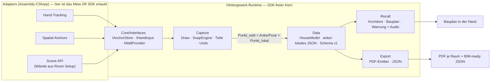

# Hintergewerk

> **Das Wissen hinter der Oberfläche.**
> *The work behind the surface — what your walls once showed, they will always remember.*

Hintergewerk ist ein VR-Werkzeug für Meta Quest, das verdeckte Installationen dokumentiert, solange die Wand offen ist — und Monate später als Sicherheitskorridor zurückbringt. Eingereicht bei der [Meta VR Start Developer Competition 2026](https://start-developer-competition-26.devpost.com/) · Track Productivity · Division New Experience.

## Die goldene Stunde

Jede renovierte Wand sagt die Wahrheit genau einmal: solange sie offen ist. Danach sieht der Monteur das Rohr nie wieder — und Monate später bohrt jemand hinein, weil das Gebäude vergessen hat. BIM-Modelle lösen das für Neubauten. Der Bestand — Millionen Altbauten — hat kein Modell. Er hat nichts.

Unsere Vision: Das Gebäude bekommt ein Gedächtnis. Der Monteur erfasst es mit der Hand, in unter 30 Sekunden pro Objekt. Wer später bohrt, sieht den Warnkorridor, bevor es teuer wird. Wer das Gebäude übernimmt, bekommt PDF und Daten-Export — den Beweis, den Bauherr und nächste Firma annehmen.

## So funktioniert es

Mit den Händen, ohne Controller — fünf Gesten, nichts sonst:

| Geste | Wirkung |
|---|---|
| Pinch + ziehen | Leitung auf der offenen Wand zeichnen |
| Zwei Hände auseinander | Einbautiefe festlegen |
| Handfläche zur Brust | Menü öffnen |
| Streichen | Rückgängig |
| Ansehen + Pinch | Objekt inspizieren: Foto, Tiefe, Monteur, Datum, Konfidenz |

Während der Monteur zeichnet, wächst in der anderen Hand der **Bauplan** — der echte Top-Down-Plan des Raums, live, mit jedem bestätigten Korridor. Hand-Tracking zittert ein bis zwei Zentimeter? Deshalb ist Präzision hier ein System-Feature: Raycast-Snapping auf Wandebenen, 5-cm-Raster, magnetische Endpunkte — und statt einer Haarlinie ein ehrlicher Sicherheitskorridor von ±5–6 cm, der beim Herannahen eskaliert (Farbe, Helligkeit, richtungsbehafteter Audio-Ping).

## Architektur

Der Kern ist absichtlich SDK-frei: die Assembly `Hintergewerk.Runtime` enthält kein einziges `OVR*`-Symbol. Alles, was das Headset kann, fließt über schmale Interfaces; die Adapter liegen außerhalb und sind austauschbar. Dadurch läuft die gesamte Logik im Meta-XR-Simulator und in 109 Unit-Tests — ohne Gerät.



Vier Invarianten tragen alles (Details: [AGENTS.md](AGENTS.md)):

1. **Geometrie ist anker-lokal gespeichert** — nie Weltkoordinaten. Anker-Drift und Re-Lokalisierung können einen erfassten Verlauf nicht korrumpieren.
2. **Schema-Versionierung** — jede Datenmodell-Änderung migriert; der Parser überspringt unbekannte Keys (Forward-Kompatibilität).
3. **Auto-Save** — jede Mutation persistiert sofort. Es gibt keinen Speichern-Knopf, weil es keinen „fertig"-Moment gibt.
4. **Der PDF-Export ist ein selbst geschriebener Emitter** ohne Abhängigkeiten — derselbe Top-Down-Projektor, der auch den Bauplan in der Hand rendert. Eine Quelle der Wahrheit, live statt auf Papier.

## Die Ehrlichkeitsregel

> Wir behaupten nicht, durch Wände zu sehen. Wir erinnern, was dokumentiert wurde.

Jedes Objekt trägt eine sichtbare Konfidenz (`gemessen` / `geschätzt` / `Sucher`). „Nicht gefunden" heißt nie „nicht vorhanden" — ein leerer Raum heißt: hier wurde nichts dokumentiert. Verwaiste Objekte (Anker nicht mehr auffindbar) bleiben als „nicht verortbar" in der Liste, sie werden nie stillschweigend gelöscht.

## Stand (ehrlich, zum Abgabezeitpunkt)

- ✅ **109/109 Unit-Tests grün**; kompletter Capture-Flow (Zeichnen → Typ → Tiefe → Foto → Confirm → Bauplan → Export) als durchgehender Beweislauf im Meta-XR-Simulator reproduziert
- ✅ Korridore in Typfarben, Auto-Raum-Zuordnung über mehrere Räume, PDF+JSON-Export mit echten Capture-Daten
- 🟡 **Gerätetests M1–M3** (Anker-Persistenz über echten Neustart, echtes Room-Setup) offen — das Abgabe-Video zeigt den Simulator und kennzeichnet das ab Sekunde eins
- ✅ Persistence so, wie wir sie zeigen können: gespeicherte Verläufe überleben komplette App-Neustarts. Wie viele Tage und Neustarts es am Gerät sind, messen wir, bevor wir es behaupten.

## Projekt-Tagebuch (Blog, 4 Sprachen)

| Version | Link |
|---|---|
| Deutsch | [docs/blog/hintergewerk.de.md](docs/blog/hintergewerk.de.md) |
| English | [docs/blog/hintergewerk.en.md](docs/blog/hintergewerk.en.md) |
| Leichte Sprache | [docs/blog/hintergewerk.de-einfach.md](docs/blog/hintergewerk.de-einfach.md) |
| Simple English | [docs/blog/hintergewerk.en-simple.md](docs/blog/hintergewerk.en-simple.md) |

## Dokumentation

Die Arbeit hat hier ein öffentliches Gesicht; die internen Planungs-Docs (Zeitpläne, Checklisten, Feldvorlagen) liegen bewusst außerhalb des Repos.

| Doc | Inhalt |
|---|---|
| [docs/adr/](docs/adr/) | ADRs: die großen Architektur-Weichen im Detail |
| [AGENTS.md](AGENTS.md) | Konventionen + Invarianten für jede Session |
| [docs/blog/](docs/blog/) | Projekt-Tagebuch in 4 Sprachen (siehe oben) |
| [testdata/beispielhaus.json](testdata/beispielhaus.json) | Beispieldaten im Schema v1 |

## Selbst bauen

Unity 6 LTS + Android Build Support, Projektordner `unity/`:

```
"C:\Pfad\zu\Unity.exe" -batchmode -quit -projectPath <repo>\unity ^
  -executeMethod Hintergewerk.EditorTools.BuildScript.BuildAndroid -logFile build.log
```

Ergebnis: `unity/Builds/hintergewerk.apk` (ARM64). Ohne Gerät verifizieren: Unity-Menü **Hintergewerk → Kern-Selbsttest (JSON-Roundtrip)** und EditMode-Tests im Test Runner. Der Meta-XR-Simulator reicht für Iteration — das Gerät ist die letzte Wahrheit.

## Links

- Wettbewerb: https://start-developer-competition-26.devpost.com/
- Devpost-Video: `docs/video-assets/hintergewerk_sim_demo_de.mp4` (DE) / `..._en.mp4` (EN)
